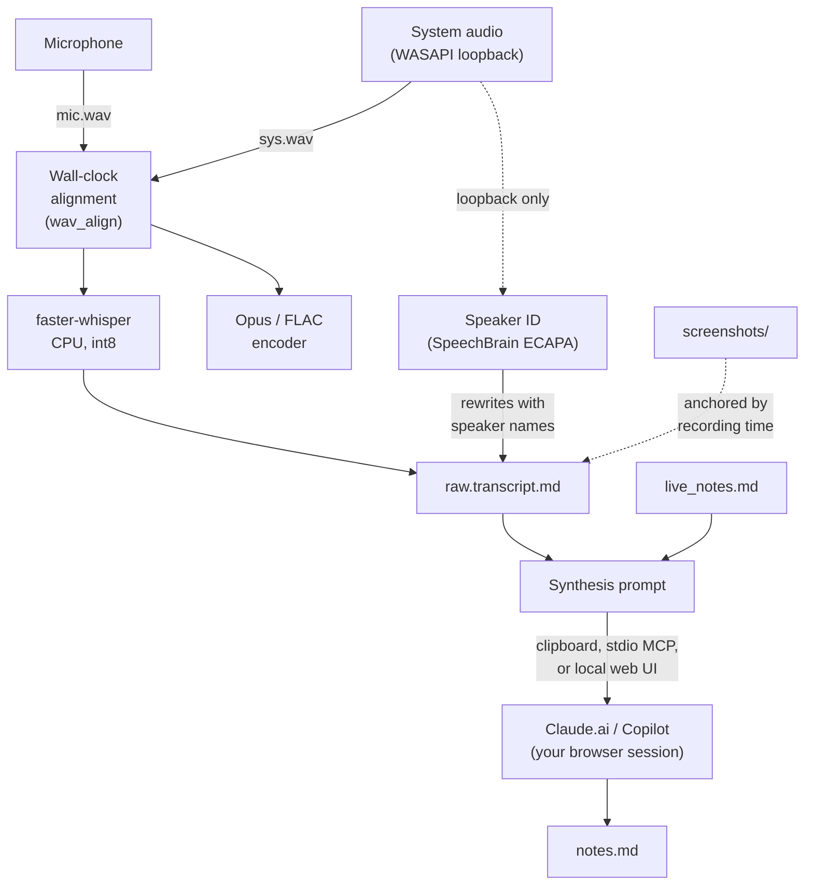
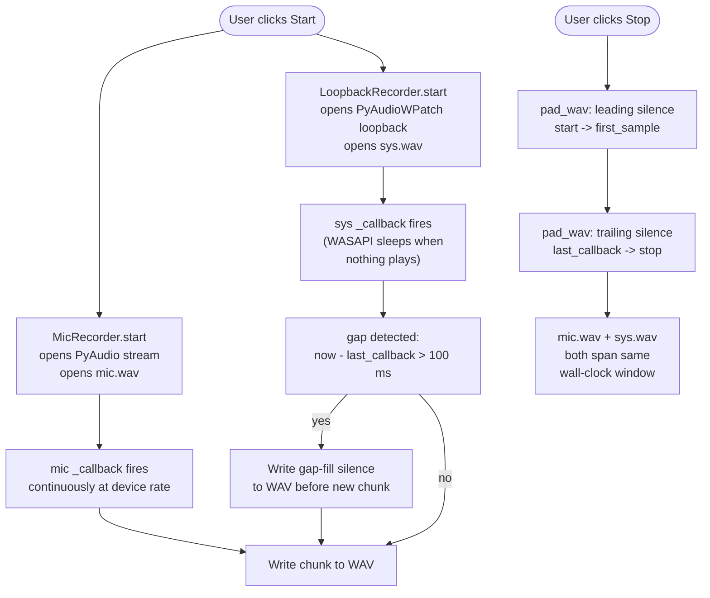
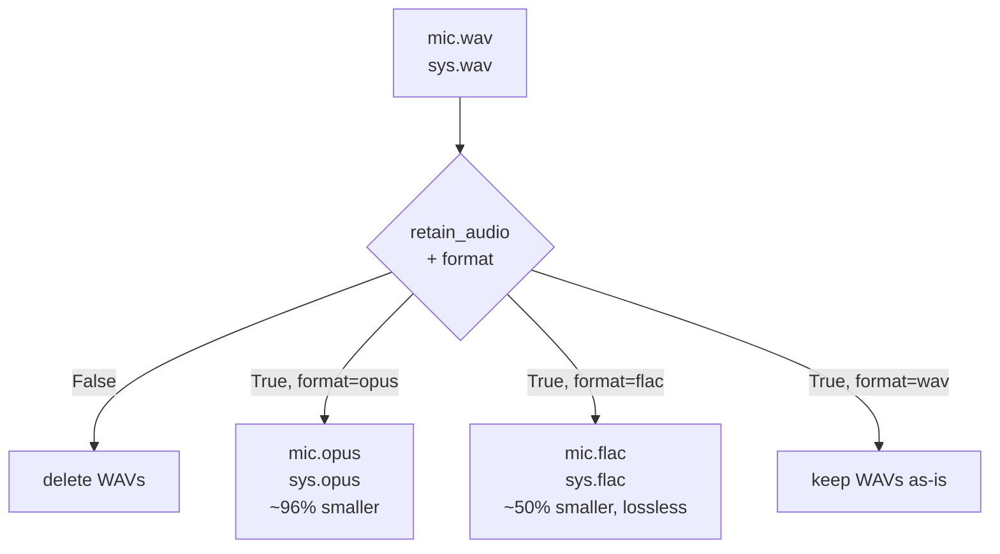
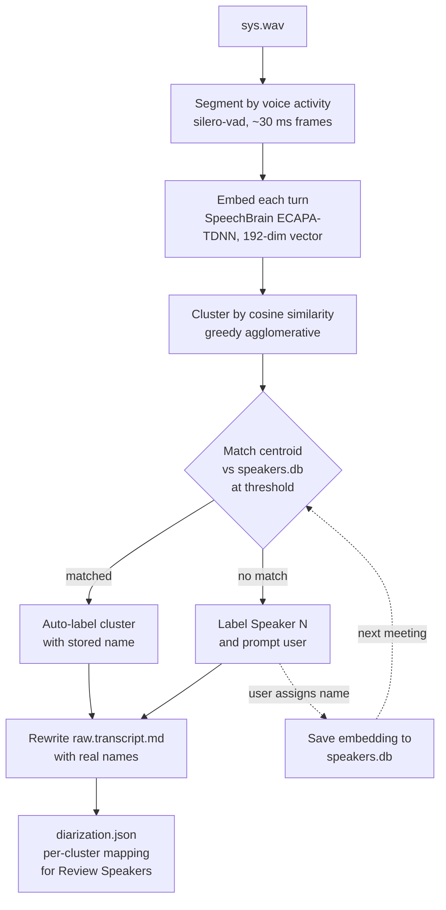
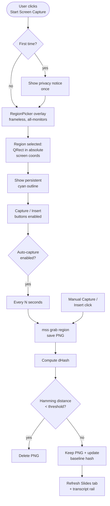
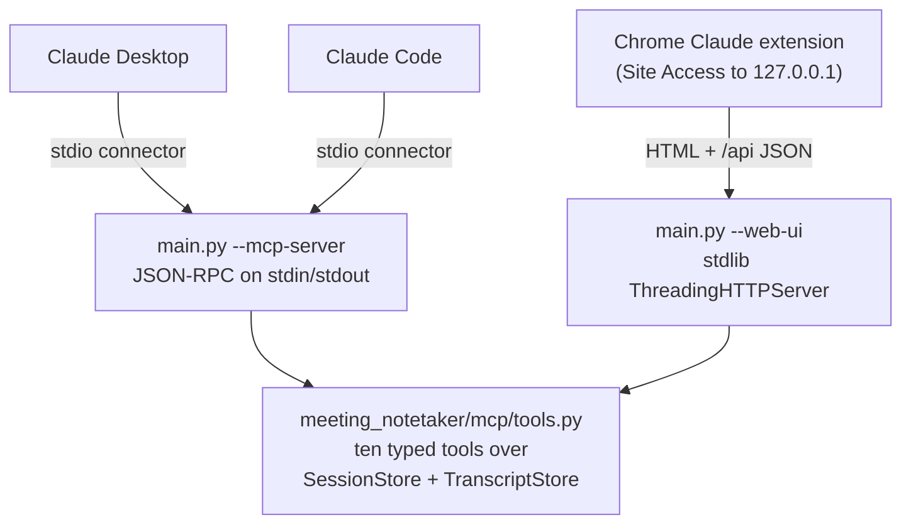
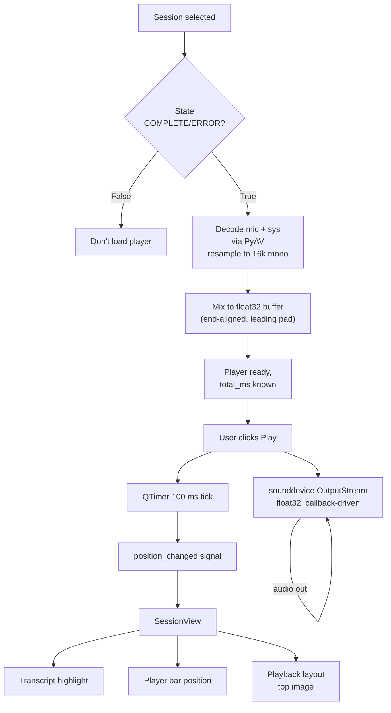

# Meeting Notetaker

Local meeting capture for Windows. Records your microphone and the
system audio (whatever is playing through your speakers, including
Teams / Zoom / Meet calls), transcribes both streams on-device with
faster-whisper, captures screenshots of any region you draw, plays
the recording back in-app, and hands the resulting transcript to you
for synthesis by any LLM you trust. Synthesis routes through a local
Model Context Protocol (MCP) service layer; a stdio MCP server for
Claude Desktop and Claude Code, and a loopback web UI the Chrome
Claude extension can drive. The manual Generate Prompt + Paste
Response Back flow stays available when you'd rather handle it by
hand. No audio leaves the machine; no API key required.

## What's new in v0.8 (pre-release)

v0.8 retires the bundled Chrome extension in favor of a local MCP
service layer with two transports. See
[docs/mcp-setup.md](docs/mcp-setup.md) for the one-page setup.

- **stdio MCP server** (`main.py --mcp-server`): for Claude Desktop
  and Claude Code, which take a stdio connector config. Ten typed
  tools expose list / read / render-prompt / save / export directly.
- **Loopback web UI** (`main.py --web-ui`): for the Chrome Claude
  extension, which only accepts remote connector URLs and cannot
  consume a stdio config. Serves a 127.0.0.1 page (port 8765 up to
  8785) plus a JSON API mirroring every tool.

The old automation path is gone: no more unpacked-extension install,
no more native-messaging host, no more selector hunts against
claude.ai's shifting markup. Everything the synthesis flow needs
(list meetings, read transcripts, render a prompt, save notes,
export to Obsidian/Notion/Confluence) now sits behind MCP tools your
Claude surface calls directly or drives through the web UI.

To migrate: tick **Enable synthesis via MCP** in Settings >
Synthesis via MCP, then paste the stdio config snippet into Claude
Desktop or Claude Code, or click **Start web UI and open in
browser...** for the Chrome Claude extension path. The clipboard
Generate + Paste Response Back flow is unchanged and remains the
fallback for anyone not on either transport.

If you installed the v0.7.x bundled Chrome extension via the old
Settings > Synthesis Automation > Install / Verify button, three
artifacts outside the git tree persist across the v0.8 upgrade and
need a one-time hand cleanup. Chrome's extension service worker will
otherwise wake every few seconds, invoke the registered native host,
and spawn a Python process from the install's venv for no useful
reason. The three to clear:

1. The extension itself. Open `chrome://extensions/`, find Meeting
   Notetaker (ID `gmnecenhibfigbpldhacjhgmooopeelo`), click Remove.
   Repeat in Edge if you ever loaded it there.
2. The HKCU registry keys that point Chrome at the native host.
   `regedit` to
   `HKEY_CURRENT_USER\Software\Google\Chrome\NativeMessagingHosts\com.meeting_notetaker.bridge`
   and delete the key. Same path under `Software\Microsoft\Edge\...`
   for Edge.
3. The on-disk host files, now orphaned. Delete
   `%LOCALAPPDATA%\MeetingNotetaker\extension\` and
   `%LOCALAPPDATA%\MeetingNotetaker\automation\`.

Step 1 alone stops the respawns; steps 2 and 3 remove the dead
pointers so a stray service worker from a reinstalled extension
can't start up the loop again.

Status at v0.7.14 released, v0.8.0 in pre-release. End-to-end capture, transcription, synthesis,
screen capture, retained-audio playback + export, and transcript-
synchronized playback all working. v0.7.14 keeps the app alive when
an exception escapes a Qt slot and lets you re-transcribe a crashed
recording. Previously PyQt6 turned any such exception into
`qFatal()`, and the windowed Windows build has no stderr and no
console, so the process vanished with nothing in the log; on top of
that, `__fastfail` on Windows bypasses the faulthandler hook the
MainLoopWatchdog installs. `utils/crash_guard.py` now installs
`sys.excepthook`, `threading.excepthook` and a Qt message handler at
startup, so the traceback lands in `meeting_notetaker.log` with
"Unhandled exception (app kept running)" and the status bar surfaces
a brief notice. One concrete trigger is fixed in the same release:
`_on_session_list_sort_changed` referenced a `_save_split_timer`
only created by the transcript/playback splitter handler, so a
Date/Title header click before any splitter drag raised
`AttributeError` and killed the app; present since v0.6.5. File >
Transcribe Failed Recording (also on the session list's right-click
menu) re-runs the batch + speaker pipeline over the WAVs a crashed
session left on disk; orphaned per-endpoint `sys.N.wav` sidecars
are mixed into `sys.wav` off the GUI thread first. The batch pass
is forced on and the audio is always kept for this path, so a bad
transcription never costs the source. `mix_sidecar_wavs` now streams
in ~1 s blocks (a 75-minute four-endpoint meeting is ~3.5 GB of PCM;
the old in-memory algorithm peaked several times that). The session
list is refreshed after crash recovery so the error badge and the
new action appear immediately. Builds on v0.7.13's composer
selector-priority walk and `pasteIntoComposer` grow assertion,
v0.7.12's TipTap fix (`chrome.scripting.executeScript` with `world:
'MAIN'`) and Settings > Edit Prompts crash fix.
`scripts/probe-claude.js` also gains a broad button snapshot when
strict send-button selectors match zero, so a future DOM rename
surfaces the new label without another round-trip. v0.7.11 shipped a stack of fixes
and UI polish on top of v0.7.10's Save to Obsidian: the Appendix
tray no longer collapses after an editor flush, Save / Print
buttons re-evaluate correctly after synthesis lands, calendar
invites drop signature images + bridge boilerplate at import,
PDF and Word exports run off the UI thread with status-bar
progress, the Slides tab gains multi-select delete, and the My
Notes editor gains an Insert Screenshot picker. v0.7.10 added
Save to Obsidian (local vault publish with frontmatter, image
dedup, daily-note backlink, re-publish detection); v0.7.9 added
audio robustness fixes plus the #93/#94 PDF and Word export
pipeline. v0.7.6 added Notion and Confluence as save-to
destinations alongside PDF. Earlier v0.7.x layered a unified
Appendix system on top of the v0.7.2 Contact model: four
LLM-emitted sections parsed into a sidecar JSON store, surfaced
in a collapsible tray, edited via a tabular dialog, and bundled
into preview / PDF / ZIP exports as Markdown tables.

**What this tool is.** A note-synthesis pipeline, not a verbatim
transcription product. The transcript exists to seed an LLM
synthesis pass; the LLM smooths the kinds of errors a CPU-only
Whisper run produces (homophones like "there" vs "their", mild
punctuation drift, occasional dropped articles). If you need
legal-grade verbatim transcripts, use Teams' built-in
transcription or a hosted service -- this app trades raw accuracy
for local-only processing, low CPU cost, and an LLM-friendly
transcript that synthesizes well.

**Diarization (speaker identification) is rough.** The current
pass reliably separates two or three distinct voices in clean
audio, but a four-person meeting routinely splits into 20+
"speakers" depending on mic, codec, and noise floor. The goal is
*sufficient speaker context to attribute concepts and discussion
threads to the right person* -- not perfect labeling. The
synthesis prompt sees speaker labels as hints, and the LLM is
fully capable of reconciling "Speaker 7 and Speaker 12 are likely
the same person" given the surrounding text. Tunable merge /
match thresholds in Settings, plus live click-to-tag during
recording, let you correct in-meeting.

## Why this exists

Many workstations forbid:

- Sending audio or transcript content out to an external API.
- Synthesizing via any LLM other than an approved one.

SaaS meeting-note tools (Granola, Otter, Fireflies, and similar)
generally violate one or both. This app moves transcription
on-device and keeps the synthesis step either fully manual (paste
the prompt, paste the response back) or controlled by a Chrome
extension that uses your existing browser session with the LLM --
the user is always the explicit transport between the local
transcript and the LLM provider. No audio, no transcript, no API
keys ever leave the machine.

---

# User Guide

The day-to-day usage walkthrough is split across the pages under
[docs/user-guide/](docs/user-guide/README.md):

- [Getting started](docs/user-guide/getting-started.md): requirements
  and the four install paths.
- [Recording and notes](docs/user-guide/recording.md): running a
  session, My Notes, screen capture, playback, exporting the
  recording, transcribing a crashed recording, and importing a
  transcript.
- [Synthesis](docs/user-guide/synthesis.md): manual clipboard
  hand-off, and the MCP service layer (stdio for Claude Desktop /
  Code; loopback web UI for the Chrome Claude extension).
- [Publishing notes](docs/user-guide/publishing.md): Save to Notion,
  Confluence, and Obsidian.
- [Speaker identification](docs/user-guide/speakers.md): the
  on-device recognition pipeline and how to tune it.
- [Settings and backups](docs/user-guide/settings.md): the full
  Settings reference table plus the backup / restore flow.

The in-app Help > User Guide... menu item opens this page directly.
Technical internals (recording pipeline, diarization, service layer)
live in the [Technical Details](#technical-details) section below.

---

# Technical Details

This section is for understanding how the pieces fit together (for
debugging, contributing, or just curiosity). Day-to-day use only
needs the User Guide above.

## Architecture overview



The WASAPI loopback path is adapted from
[Danaor/WhisperType](https://github.com/Danaor/WhisperType).

## Recording pipeline



The load-bearing piece for keeping mic.wav and sys.wav aligned is
wall-clock-driven WAV padding. WASAPI loopback doesn't deliver
samples when the Windows audio engine is asleep (nothing playing
through the speakers), so without intervention sys.wav would be
shorter than mic.wav and the system-audio content would land at
the wrong moment in playback / transcription. Three places fix
this:

1. **First-sample delay** -- between `start()` and the first
   callback, no samples arrive. At stop, `pad_wav` prepends
   silence to cover that window.
2. **Mid-recording gaps** -- if WASAPI stops firing callbacks
   during a silent stretch, the next callback's wall-clock delta
   exceeds the frame time. The recorder writes the missing
   silence into the WAV before the new chunk.
3. **Trailing dropout** -- after the last callback and before
   `stop()` is called, no samples arrive. At stop, `pad_wav`
   appends silence to fill.

After all three pads, mic.wav and sys.wav both span exactly
`[start_wallclock, stop_wallclock]` with audio in the right
positions. Everything downstream (transcription, encoder, player,
export) sees naturally-aligned files.

### Audio retention

If the user kept "Retain audio" for the session, after the batch
transcription pass commits, the WAVs are re-encoded to the
configured format (Opus / FLAC / WAV) and the WAVs are deleted.



Each encode preserves the wall-clock alignment from the source
WAV (PyAV decode + resample writes the same duration out the
other side).

## Transcription

Two Whisper passes can run for every recording (one or both,
depending on Settings):

- **Live transcription**, while recording (off by default in
  v0.6.5). Each source (mic + system audio) runs as its own
  background worker, popping 10-second windows with 5-second
  overlap from a ring buffer. Each window is decoded as it
  arrives.
- **Batch refinement**, after Stop. The full mic + sys WAV files
  are re-transcribed end-to-end so Whisper has the entire
  context to lean on. Quality is slightly higher (better
  punctuation, fewer split sentences). On CPU this is roughly
  **real-time** -- a 30-minute meeting on `small.en` takes ~30
  minutes of CPU to refine.

You don't have to wait for the refinement pass before
synthesizing. The status label switches from "Recording" to
**"Refining transcript -- you can synthesize now"** the moment
Stop completes; Generate / Paste / Send are immediately
available. Anything you do during refinement uses the live
transcript; if you re-generate after refinement finishes, the
better version is used automatically.

### Choosing a model

| Size | Disk | Quality | Notes |
|---|---|---|---|
| `tiny.en` | ~75 MB | Low | Useful only if your CPU is very slow or you just need keyword-level signal. |
| `base.en` | ~145 MB | OK | A reasonable smaller default. |
| `small.en` | ~480 MB | Good | Recommended for real meetings. |
| `medium.en` | ~1.5 GB | Best | ~3x slower than small.en. Use for high-stakes recordings if you have CPU headroom. |

### Speaker identification pipeline



The mic channel is always the user; it doesn't go through this
pipeline and keeps its `{{user_name}}:` / `Me:` rendering.

After Stop, the controller chains:

1. **Final transcription** (the batch pass; rewrites the live
   transcript with a cleaner version).
2. **Voice segmentation** on `sys.wav`: silero-vad chops the
   loopback channel into per-turn voiced spans (typical meeting:
   30-200 turns). Falls back to webrtcvad and then an energy
   threshold if silero / torch can't load.
3. **Embedding**: SpeechBrain's ECAPA-TDNN produces a 192-dim
   vector per turn. Voiced turns shorter than 1.0 s are skipped
   because short-clip embeddings are unreliable.
4. **Clustering**: greedy agglomerative cosine merge collapses
   turns into per-speaker clusters (Merge threshold tunable).
5. **Matching**: each cluster centroid is compared against every
   name in `speakers.db`. Above the threshold, the cluster
   auto-labels with the stored name.
6. **Transcript rewrite**: `raw.transcript.md` is rewritten with
   the resolved names where matched, `Speaker N` fallback where
   not.
7. **`diarization.json` saved** alongside the transcript so the
   Review Speakers walker works on this session forever, even
   after `sys.wav` is cleaned up.
8. **Unknown-speaker dialog**: if any cluster didn't match, the
   Label Unknown Speakers dialog pops with example transcript
   lines per cluster.

### Limits of the diarization

This is a small CPU-only model running on recorded audio. It is
good at distinguishing two or three clearly-different voices in a
quiet meeting. It struggles with:

- **Overlapping speech.** Cross-talk produces a turn with mixed
  embeddings; the cluster goes somewhere ambiguous.
- **The same person on different microphones.** A colleague who
  joins one meeting from a headset and another from a phone
  speaker may not match across meetings. The match threshold is
  the knob; loosening it improves recall on this case at the cost
  of more false matches.
- **Very short utterances.** A "thanks" or "agreed" turn under
  half a second gets dropped by the segmenter.
- **Channel changes.** Different Teams / Zoom audio paths,
  bluetooth-vs-USB, codec changes, or aggressive noise
  suppression can shift the embedding enough to miss a match.

### Tuning diarization thresholds

The two knobs in Settings (default 75% each) control different
stages of the speaker-identification pipeline.

**Merge threshold** -- governs clustering *within* a single
meeting:

| Symptom | What to do | Try first |
|---|---|---|
| Four people show up as 20+ "Speaker N" clusters. | Lower the merge threshold. | **0.60**, then 0.55 |
| Two distinct people keep merging into one cluster. | Raise the merge threshold. | **0.80**, then 0.85 |

Over-splitting is the more common failure mode, so try
**lowering merge first** if unsure.

**Match threshold** -- governs *cross-meeting* recall against
`speakers.db`:

| Symptom | What to do | Try first |
|---|---|---|
| A labeled colleague keeps coming back as "Speaker N". | Lower the match threshold. | **0.70**, then 0.65 |
| A cluster gets auto-named with the wrong stored speaker. | Raise the match threshold. | **0.80**, then 0.85 |

Both thresholds are saved to `config.toml` and take effect on
the *next* speaker-identification pass.

## Screen capture



Screenshots land in `<session>/screenshots/NNNN-YYYYMMDDTHHMMSSZ.png`
where NNNN is a monotonic sequence number. During playback (or
when the user clicks a transcript line while paused), the
Transcript tab swaps to a vertical split (image on top,
transcript below) with the active image following the
sticky-latest rule (the most recent screenshot whose offset
&lt;= current playback position). The split defaults to 70/30 top
versus bottom; the user can drag the divider and the new ratio
persists to `config.toml` (`ui.transcript_playback_split_top_pct`).

The **Slides** tab has its own player bar that mirrors the
Transcript tab's bar; both bars reflect a single AudioPlayer
state. Clicking a thumbnail in the Slides tab while audio is
loaded seeks the player to that screenshot's recording-relative
timestamp.

## Synthesis service layer deep-dive



`meeting_notetaker/mcp/tools.py` is the single source of truth
for every exposed operation. Both transports call into it:

- The stdio server (`meeting_notetaker/mcp/server.py`) implements
  the MCP protocol version 2025-06-18 as newline-delimited
  JSON-RPC over stdin and stdout. Claude Desktop and Claude Code
  launch it on demand from their connector configs; nothing
  binds a socket.
- The web UI (`meeting_notetaker/web/`) wraps the same tools in
  HTML pages (for Chrome Claude to drive) and in a parallel JSON
  API under `/api/` (for scripts). The server is a stdlib
  `ThreadingHTTPServer`; no Flask, no Django, no extra wheel.

The web UI's export dropdown is populated by `list_export_destinations`,
whose rows are gated on two conditions: the destination has to be
configured and verified under Settings > Integrations, and the
user has to have ticked it in Settings > Synthesis via MCP >
Web UI export destinations. The dropdown posts to
`/meetings/<id>/export`; legacy per-destination routes
(`/export/obsidian`, `/export/notion`, `/export/confluence`)
stay available for scripts that want to pick a destination
without reading the dropdown.

Launching the web UI from the command line:

```
meeting-notetaker.exe --web-ui                   # loopback, auto-open browser
meeting-notetaker.exe --web-ui --no-open         # no browser launch
meeting-notetaker.exe --web-ui --port 8800       # pick a starting port
```

`--mcp-server` has no flags: it reads JSON-RPC on stdin and
writes to stdout. The single-instance lock is deliberately
bypassed in that mode so a Claude client can spawn the server
alongside a running GUI.

## Audio playback + transcript sync



Each stream gets a generation id (monotonic counter) so a queued
finished_callback from a previously-stopped stream can't tear
down a newer one. This is the load-bearing piece for click-to-
seek during playback: `seek_ms` synchronously stops the old
stream and starts a new one; without the generation check, the
old stream's queued callback would close the new stream and stop
the position tick.

On buffer drain, the audio callback raises
`sounddevice.CallbackStop`, the stream tears down cleanly, and
the next play() builds a fresh stream from scratch.

## Storage layout

```
%APPDATA%\MeetingNotetaker\
  sessions.db                    # SQLite session + folder metadata (WAL)
  speakers.db                    # SQLite speaker library
  config.toml                    # user settings
  instance.lock                  # single-instance pidfile
  meeting_notetaker.log          # rotating app log
  models\                        # faster-whisper model cache
  prompts\                       # user-editable synthesis prompts
  vocabulary.txt                 # user-editable global hotwords
  sessions\
    <session-uuid>\
      raw.transcript.md          # interleaved transcript, source-labeled
      live_notes.md              # your own running notes
      notes.md                   # latest LLM-generated notes
      notes-YYYYMMDD-HHMM.md     # archived prior notes
      diarization.json           # per-cluster speaker mapping + centroids
      metadata.json
      audio\                     # mic + sys WAV / Opus / FLAC
      images\                    # images pasted into live_notes / notes
      screenshots\               # captured screenshots (NNNN-<ts>Z.png)
```

## Performance tuning

If the refinement wait bothers you:

- **Smaller model.** `base.en` is roughly 3x faster than
  `small.en` for both live and batch passes.
- **Skip post-Stop refinement.** Settings -> Skip post-Stop
  refinement = on. No CPU cost after Stop; the live transcript
  is final.
- **Tune CT2 manually.** The defaults assume the app should auto-
  pick threads + workers from your physical core count. If you'd
  rather drive it yourself, the `CPU threads per worker` +
  `Parallel workers` settings give you direct control. Total OS
  threads = `threads * workers`; keep that product at or below
  your physical core count to avoid oversubscription.
- **Retain the audio.** Per-session "Keep audio" toggle keeps
  the source files. If you ever want to re-run Whisper with a
  different model or settings, the source is there.

Two-source recordings get a free 2x speedup on the refinement
pass: both sources run in parallel on different CPU cores.
Single-source recordings (mic only) get no benefit.

## Synthesis prompts

Bundled prompts seed `%APPDATA%\MeetingNotetaker\prompts\` on
first run:

- `default.md` -- generic meeting (Attendees / Agenda / TL;DR /
  Decisions / Notes / Action Items / Open Questions / Verbatim
  Quotes; merges live notes with transcript)
- `one-on-one.md` -- 1:1 retrospective shape (topics, commitments
  by side)
- `standup.md` -- yesterday / today / blockers per speaker

**Adding your own prompts.** Drop any `*.md` file into the
prompts directory. It appears in the template picker. Filename
(sans extension) becomes the display name; `my-team-retro.md`
shows as "My Team Retro".

**Placeholders:**

| Placeholder | What it expands to |
|---|---|
| `{{session_title}}` | The session's title |
| `{{date}}` | The session's creation date (`YYYY-MM-DD HH:MM`) |
| `{{transcript}}` | The full transcript body. |
| `{{live_notes}}` | The body of the My Notes tab. |
| `{{attendees}}` | Comma-joined list of names from `# Attendees` bullets. |
| `{{user_name}}` | The value of the "Your name" setting. Empty -> `Me`. |

**Upgrading.** Bundled prompts get new revisions across releases.
If you haven't edited a template (its on-disk body matches the
version that shipped with a prior release), the app refreshes it
automatically on startup. Any prompt you've actually edited is
never touched.

## Paste-target coverage for Copy

The Copy button on the **My Notes** and **Synthesis** tabs puts
two payloads on the clipboard at once: the raw Markdown source
(for plain-text editors) and a rendered HTML version with each
embedded image inlined as a `data:image/...;base64` URI (for
rich-text paste targets). Different destinations pick different
sides:

| Destination | Formatting | Images | Notes |
|---|---|---|---|
| Word (desktop) | yes | yes | Best target. |
| OneNote (desktop) | yes | yes | Same as Word. |
| Outlook (desktop, compose) | yes | yes | Same as Word. |
| Notion (web) | yes | yes | Notion re-uploads each data: URI to its own CDN on paste. |
| Outlook Web (compose) | yes | **no** | Microsoft's web sanitizer strips data: URIs. Formatting survives. |
| Microsoft Teams (desktop, compose) | yes | **no** | Same sanitizer. |
| Gmail (web compose) | yes | usually no | Browser-paste sanitizer varies. |
| VS Code / Obsidian / plain editors | -- | -- | Take the Markdown side unchanged. |

The image-loss is by Microsoft's deliberate XSS protection in the
web-paste pipeline. Workaround: paste the message text first,
then right-click the image in My Notes preview, **Copy Image**,
paste into Teams / OWA as a second step.

---

# Reference

## Updates

The Help menu has **Check for Updates...** (manual) and
**Upgrade...** (download + rebuild + install in place via
pyinstaller). On startup the app runs a silent weekly check
against GitHub releases for `aarondodd/meeting-notetaker`; if a
newer tag exists you see a prompt.

The Upgrade flow:

1. Downloads the release zipball and extracts it to a temp dir.
2. Runs `build.ps1` (Windows) or `build.sh` (POSIX).
3. Copies the freshly built `dist/meeting-notetaker.exe` over
   the running executable. The old binary is renamed to
   `meeting-notetaker.exe.old`.
4. Offers a **Restart now?** prompt.
5. On the next startup, the old `.exe.old` sibling is cleaned
   up automatically.

## Network and privacy

The app makes exactly one kind of outbound network call:
downloading model files from `huggingface.co` on first run (the
faster-whisper model and the ECAPA-TDNN speaker encoder). After
that, no network. All other paths (clipboard hand-off, file I/O,
transcription, speaker identification, screen capture, playback)
are on-device.

### Corporate proxies (Netskope, Zscaler, etc.)

If your workstation routes through a MITM proxy that re-signs
TLS, the first-run model download will fail with
`CERTIFICATE_VERIFY_FAILED` even though Edge / Outlook / npm all
work. Python's `httpx` (used by `huggingface_hub`) doesn't see
the corporate CA -- it has its own bundled trust list.

The app ships `truststore` (Windows only, in `requirements.txt`)
and injects it at startup. `truststore` makes Python's `ssl`
module use the OS certificate store, which already trusts the
corporate CA.

If `truststore` isn't enough (e.g. the proxy uses pinning),
pre-stage the models offline:

1. On a machine that can reach `huggingface.co`, download the
   model files. Easiest: `pip install faster-whisper` in a
   clean venv and run
   `python -c "from faster_whisper import WhisperModel; WhisperModel('small.en')"`,
   then copy the snapshot directory to a thumb drive.
2. On the work machine, drop the model files into
   `%APPDATA%\MeetingNotetaker\models\small.en\`. That directory
   should contain `model.bin`, `config.json`, and either
   `tokenizer.json` or `vocabulary.txt`.
3. Start the app. The model manager detects the local snapshot
   and never calls Hugging Face.

You can also set `HF_HUB_OFFLINE=1` in the environment to force
offline mode against the standard Hugging Face cache layout
(`models--Systran--faster-whisper-<size>/`). Either approach
works.

The ECAPA-TDNN speaker encoder follows the same pattern;
pre-stage its `<app_data>/models/ecapa/` directory if you can't
reach Hugging Face on the work machine.

## License

MIT. See [`LICENSE`](LICENSE).
