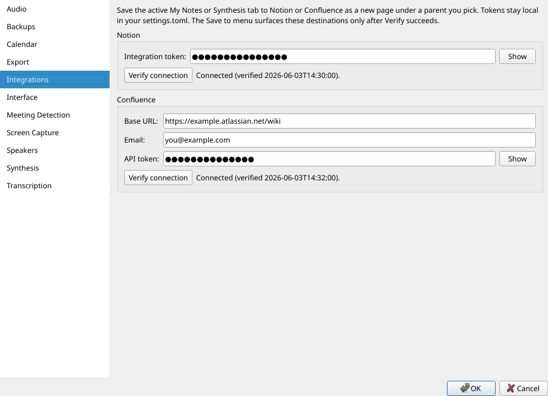
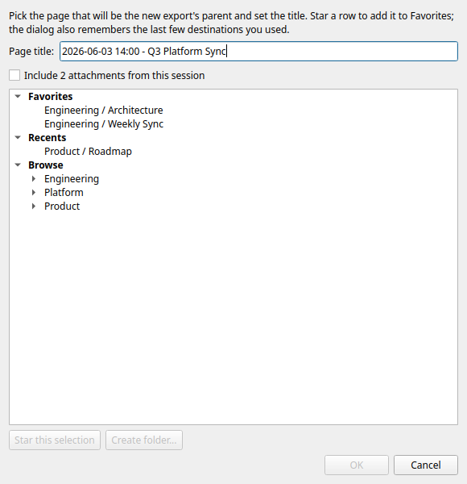

# Publishing notes

## Saving notes to Notion or Confluence

The Save to... button on the Synthesis row (and the matching File >
Save to submenu) sends the active My Notes or Synthesis tab to Notion
or Confluence as a new page. Both destinations require a one-time
setup under Tools > Settings > Integrations.

Notion: create an internal integration at
[notion.so/my-integrations](https://www.notion.so/my-integrations),
paste the integration token, click Verify connection. Share each
destination page or workspace with the integration from inside
Notion; the picker only lists pages the integration has access to.

Confluence Cloud: generate an API token at
[id.atlassian.com](https://id.atlassian.com/) (Security > API
tokens), enter your tenant base URL
(`https://your-org.atlassian.net/wiki`), your email, and the token.
Click Verify. Self-hosted Confluence Server users supply their own
base URL.

Tokens persist in `config.toml` (chmod-equivalent to user-only).
Changing a credential clears the verified-state stamp so a stale
"Connected" label can't outlive the change. The Save to menu items
only surface after Verify succeeds.

The picker dialog. When you pick Save to Notion or Save to
Confluence, a dialog opens with:

- A Page title field defaulted to `YYYY-MM-DD HH:MM - <session
  title>`. Edit it freely; whatever's in this field becomes the page
  name.
- An Include N attachment(s) checkbox (only when the session has
  attached files). When checked, each attachment uploads to the new
  page: Notion as file blocks under an "Attachments" heading,
  Confluence as page attachments with a linked list at the bottom.
- A Favorites group with destinations you've starred, a Recents
  group with the last 5 places you saved, and a Browse tree that
  lazy-loads children on expand. Entries alphabetize; recents stay
  in recency order.
- A Star this selection button to pin / unpin the current row, and a
  Create folder... button to make a new container page under the
  currently-selected destination. The Create folder dialog has a
  one-click "Use series name" affordance that fills the input with
  the session's series name (when one is set).

Click OK and the export runs on a background thread; on success your
default browser opens the new page. Re-running the export creates a
new sibling under the same parent rather than overwriting; the status
toast spells this out so previous exports stay intact.

Format fidelity. Notion exports go through a Markdown-to-block
converter that maps headings, lists (including nested plus task
lists), bold / italic / code, inline links, code fences with language
hints, quotes, dividers, tables, and inline images. Confluence
exports use the storage XML format directly, not the REST converter,
so code blocks, nested lists, and adjacent blockquotes survive
round-tripping unscathed.

Image handling. Local images in the notes body upload to the target
with the page; HTTP-hosted images stay external. Image refs the
destination can't fetch (Notion's page-attachment URLs, `cid:`,
`file://`) render as visible `*! (image: foo.png could not be
pasted) !*` placeholders rather than broken icons.

## Saving notes to Obsidian

Save to Obsidian writes the finalized synthesis into a folder of an
Obsidian vault you control. The vault is just a directory of
plaintext markdown on disk; no API, no token, no third-party plugin.
Whatever sync the user already has on the vault (iCloud / OneDrive /
Syncthing / Obsidian Sync) propagates the note to their other
machines without us doing anything.

One-time setup. Settings > Integrations > Obsidian: point the vault
path at your vault directory, then click Verify vault. The status
line reports whether Obsidian itself has the vault registered (which
it needs for the "open in Obsidian" URI to work; if the vault is not
yet registered, open it once in Obsidian and re-verify).

Per-save dialog. The picker offers:

  * Subfolder: defaults to the location template the user picked in
    Settings (`Meetings/{YYYY}/{MM}` by default; "By series", "Flat",
    or a custom template are also available); editable per-save with
    a folder browser.
  * Filename: defaults to the sanitized session title (with
    characters Obsidian forbids: `[ ] # ^ | : * ? " < > | / \`
    stripped automatically); editable.
  * Include attachments: copies the session's tracked attachments
    into the vault alongside the note, and links them in an
    `## Attachments` tail.
  * Append a backlink to today's daily note: adds a single
    `- [[path/to/note|title]], 30 min` line to the user's daily note
    (reads the user's Daily Notes core-plugin or Periodic Notes
    config to find the right file). Off by default.
  * Open in Obsidian after save: launches
    `obsidian://open?vault=<name>&file=<path>` after writing.

YAML frontmatter. Every saved note opens with a frontmatter block
carrying the session's date, time, duration, attendees, series, tags,
and `source_session_id`. The session ID is the bridge back: re-saving
the same session detects the existing note by `source_session_id` and
offers Overwrite / Save as new / Cancel so the user doesn't
accidentally produce duplicates.

Wikilinks. Attendee names and the series land in frontmatter as
`[[Alice]]` / `[[Weekly Sync]]` so they form graph nodes in Obsidian;
the body text is untouched (no auto-wikification of arbitrary names
inside paragraphs). Toggles in Settings let the user turn either
off.

Images. Local images in the body copy into
`Meetings/_assets/<session-id>/` under the vault, and the markdown
links in the note rewrite to point at the copied files. Hash-based
dedup means re-saves don't double-copy an unchanged image.

No table of contents. Obsidian has a built-in outline view in the
right sidebar, and the Outline community plugin gives the same thing
inline. We deliberately don't emit a markdown TOC into the body; it
would duplicate what Obsidian shows for free. Heading numbering (the
`number_headings` Settings toggle) still applies to Obsidian saves.
