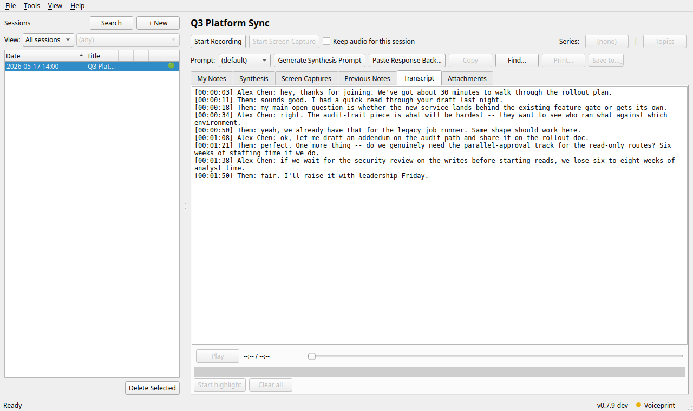
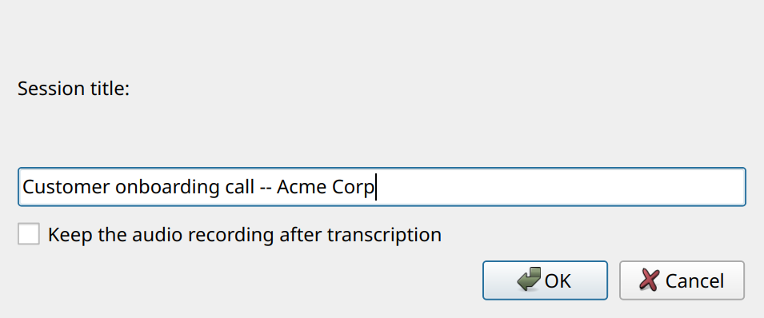
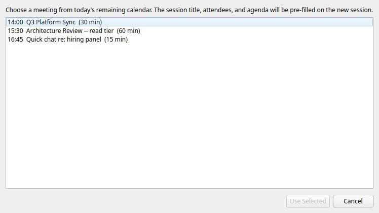
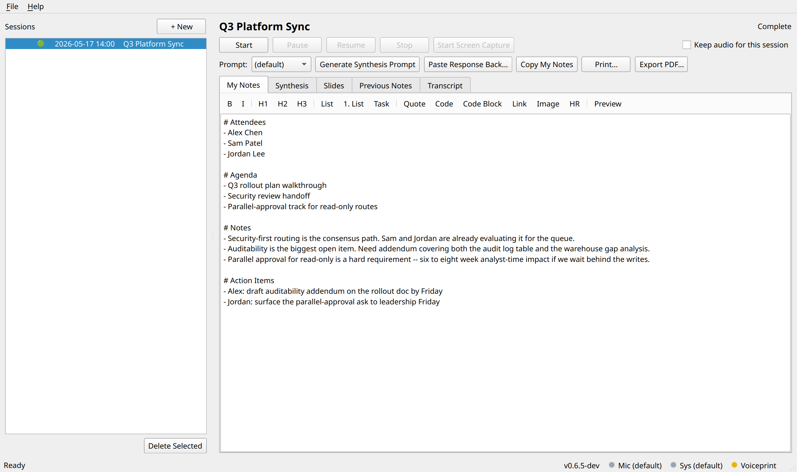
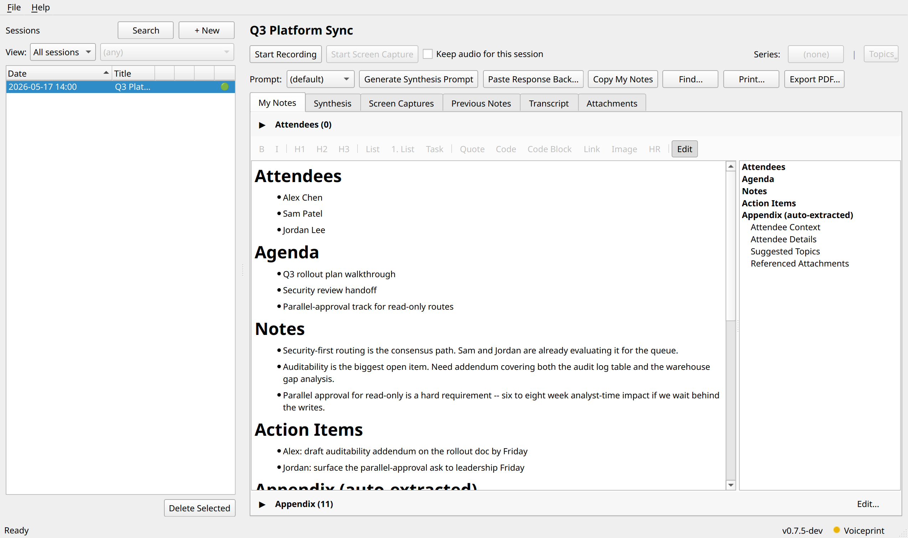
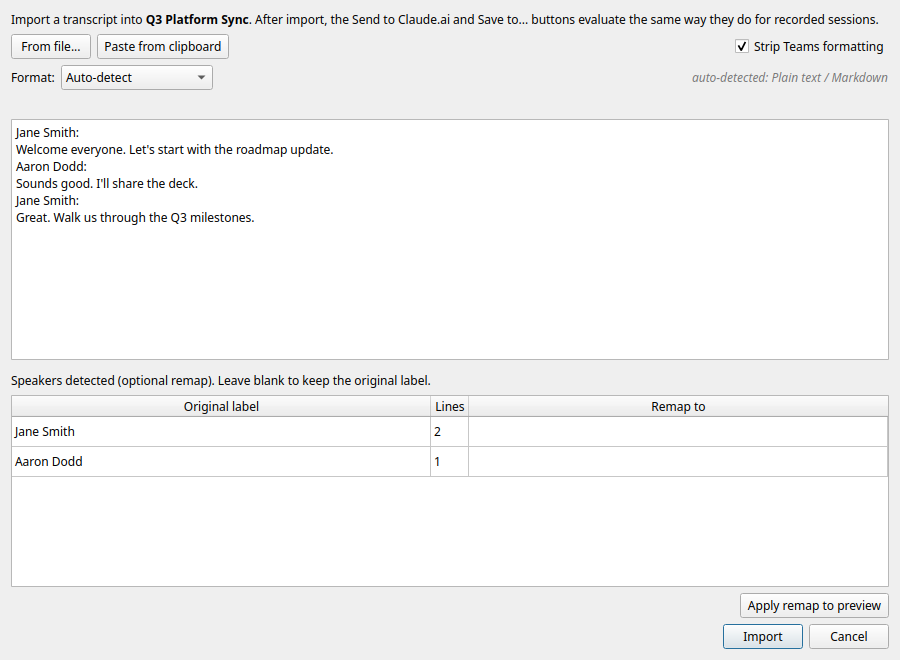

# Recording and notes

## Recording a meeting

The main window splits a session list (left) and a per-session view
(right). Recording controls sit above five tabs: My Notes (your
running buffer), Synthesis (the LLM-generated note), Slides (captured
screenshots), Previous Notes (archived prior synthesis runs), and
Transcript (live plus final transcription).



The session list has two narrow indicator columns to the left of each
title: a speaker icon if the audio recording is still on disk, and a
state dot (red while recording, yellow during the post-Stop refinement
pass, green when refined). Hover any cell to see what that column
conveys.

### The flow

1. File > New Session... (or `Ctrl+N`). Enter a title. Optionally
   tick "Keep the audio recording after transcription" to retain the
   WAV files for this session. When Outlook is reachable, a Pick from
   Calendar... button appears so you can pre-create a session for an
   upcoming meeting:

   

   

2. Select the new session in the list. Click Start. The tray icon
   turns red and pulses.
3. The transcript pane fills with lines labeled `Me:` (your mic) and
   `Them:` (system audio), interleaved by time. (Live transcription
   is off by default in v0.6.5; toggle it in Settings if you want
   lines arriving in real time during the meeting.)
4. Stop when the meeting ends. The tray shows a purple "processing"
   dot while the final transcription pass runs. When it finishes the
   tray returns to blue and the transcript view shows the refined
   final transcript.
5. Switch to the Synthesis flow. See
   [synthesis.md](synthesis.md) for both the manual clipboard
   hand-off and the MCP service layer.

## Taking notes in parallel (My Notes)

The My Notes tab is an editable Markdown buffer that lives next to
the transcript. A small toolbar above the editor handles common
formatting (Bold / Italic / Headings / Lists / Code / Image / HR /
Preview toggle).



Click Preview in the toolbar to render the Markdown in place:



Open a new session and the editor is pre-seeded with:

```
# Attendees
-

# Agenda

# Notes

# Action Items
```

Everything you type auto-saves continuously (no Save button). Names
from the `# Attendees` bulleted list are parsed out separately and
passed into the synthesis prompt as `{{attendees}}`, so action-item
owners come from the people who were actually in the meeting.

Image paste. Paste an image from the clipboard (or click Image in the
toolbar to insert a file) and the app copies it into the session's
`images/` folder and inserts a Markdown reference. The Preview pane
renders these inline.

Rich-text paste. Pastes from Notion, VS Code, GitHub, Confluence's
rendered view, Office, and similar HTML sources land as Markdown
source instead of the lossy `text/plain` variant. Headings, bold /
italic, nested lists, fenced code blocks (with language hints),
blockquotes, and links round-trip cleanly. Image references the
receiver can't fetch (Notion's page-attachment URLs, `cid:` from
email, `file://` from the source machine) render as a visible
`*! (image: foo.png could not be pasted) !*` placeholder rather than
a broken icon.

## Screen capture

The Screen Capture feature snapshots a region of your screen on
demand or every N seconds. Use it during shared-screen meetings to
keep visual context with your notes.

### Manual flow

1. While recording, click Start Screen Capture in the controls row.
2. A translucent overlay appears across all monitors. Drag to draw
   the region you want to capture (typically the shared-screen area
   in Teams / Zoom).
3. A thin cyan outline persists around the armed region for the
   duration of the recording so you can see what will be captured.
4. In the My Notes tab's right sidebar, the Capture and Insert
   buttons are now enabled.
5. Click Capture to snapshot the region into the session's
   `screenshots/` folder. Click Insert to do the same AND drop a
   markdown image-ref at the cursor in My Notes.

### Auto-capture

Tick the Auto-capture checkbox in the same sidebar. While armed, the
region is snapshotted every N seconds (default 30, set in Settings).
Each fresh capture's perceptual dHash is compared against the
most-recently-kept image; near-duplicates are discarded. Only
meaningfully-different content sticks around. Manual Capture / Insert
clicks always keep their image (no dedup check) and update the dedup
baseline.

### Viewing captured slides

The Slides tab lists every captured screenshot as a thumbnail grid:

- Click a thumbnail: switch to full-image view with Previous / Next
  / Back navigation.
- Right-click: Copy image to clipboard / Open in default viewer /
  Delete.

While playback is active (see below), the Slides tab auto-advances to
track the recording position; clicking a thumbnail seeks the audio to
that screenshot's recording-relative timestamp.

## Playing back the recording

If you kept the audio (checkbox in New Session, or default in
Settings), the Transcript tab grows a slim Play / Stop plus scrubber
plus time-readout bar at the bottom.

- Click Play: the recording plays back. The active transcript line
  highlights as audio progresses.
- Click a transcript line: the audio seeks to about 10 seconds before
  that line's timestamp and continues playing from there. The clicked
  line stays highlighted until playback catches up to it.
- Drag the scrubber: seek to any moment.
- Stop: pause where you are. The next Play resumes from the same
  spot.

If the session also has captured screenshots, hitting Play (or
clicking any transcript line while paused) swaps the Transcript tab
to a screenshare-style layout: the matching screenshot shows up top,
the transcript scrolls below. As playback crosses each captured
screenshot's recording-relative timestamp, the top image updates. The
split defaults to 70% screenshot / 30% transcript; drag the divider
to resize and the new ratio is remembered for future sessions.
Pausing keeps the layout up; only natural end of playback returns to
the full-width transcript view.

The Slides tab also gets its own Play bar that drives the same
player.

## Exporting the recording

Right-click any session with a retained recording in the session
list:

- Open recording in media player: launches your OS default player on
  the source file.
- Export recording as...: opens a save dialog with filter options for
  MP3 (default, most universal), FLAC, AAC, Opus, or WAV. Both source
  streams (mic plus sys) are mixed into a single file at the chosen
  format. An indeterminate progress dialog shows while encoding runs
  in a worker thread.
- Export session as video...: renders an MP4 slideshow with the mixed
  audio plus screenshots flipping at their captured timestamps. H.264
  1080p / 30 fps video, AAC mono audio, black frames before the first
  screenshot, letterbox bars to preserve aspect ratio. A matching
  `.srt` sidecar carries the transcript as toggleable subtitles;
  every standard player auto-loads the SRT and lets the viewer turn
  subtitles on or off; delete the SRT if you'd rather share the MP4
  alone. A determinate progress dialog tracks per-frame encode
  progress.
- Delete recording...: removes the audio files but keeps the
  transcript and notes.

## Transcribing a failed recording

If the app exits while a session is recording, the next launch marks
that session as failed (the red cross in the state column) and lists
it in a Crash Recovery dialog. The audio captured up to that point is
still on disk. Select the session and choose File > Transcribe Failed
Recording... (also on the session list's right-click menu) to run the
full transcription and speaker pass over it. With multi-endpoint
capture on, the per-endpoint system-audio tracks the interrupted
recording never mixed are combined first. The audio is kept
afterwards even if the session was not set to keep its recording, so
a bad transcription pass never costs you the source.

## Importing a transcript (no recording)

Sometimes a meeting happens without a local recording: you joined
late, your mic was wrong, Teams recorded the call but the app didn't,
or the meeting was a hallway call with someone else's transcript
already on hand. You can still use the synthesis flow by importing
the transcript directly into the session.

1. Create a new session in the usual way (the + New button in the
   sessions list), or open an existing empty session.
2. Click Import Transcript... on the empty Transcript tab, or pick
   File > Import Transcript... from the menu bar.
3. In the dialog, either click From file... (accepts `.txt`, `.md`,
   and `.docx`) or Paste from clipboard. The preview pane shows the
   normalized body the app would save.

   
4. Leave Strip Teams formatting checked for transcripts that came
   out of Teams. The cleanup pass drops boilerplate banners ("Started
   transcription", "View original meeting"), folds the web-paste
   three-line speaker/timestamp/body shape back into one labeled
   line, and collapses runs of blank lines. Uncheck it to import the
   source verbatim.
5. If the preview shows `Name:`-prefixed lines the dialog lists each
   detected speaker, how many lines they contributed, and lets you
   type a remapped label. Useful when Teams used a generic "Unknown
   Speaker" label or the user's display name is wrong. Click Apply
   remap to preview to see the result.
6. Click Import. The body is written to the session's transcript and
   the Generate Synthesis Prompt and Save to... buttons become
   available the same way they do after a recording.

Notes are merged in via the existing My Notes flow; if you took
running notes during the meeting they remain attached to the session
and feed the synthesis prompt alongside the imported transcript. A
flat caption blob with no speaker labels works fine; the synthesis
prompt template treats `{{transcript}}` as opaque text, and Claude
leans on your notes when speaker attribution is missing.

Importing over an existing transcript prompts for confirmation to
avoid accidentally wiping a recording's transcript.
