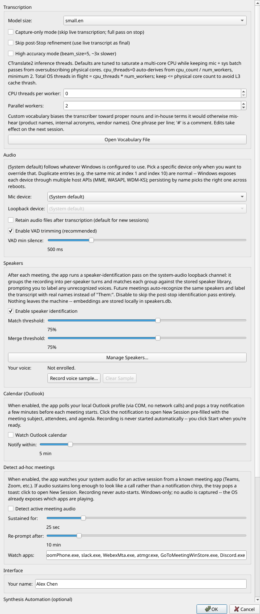
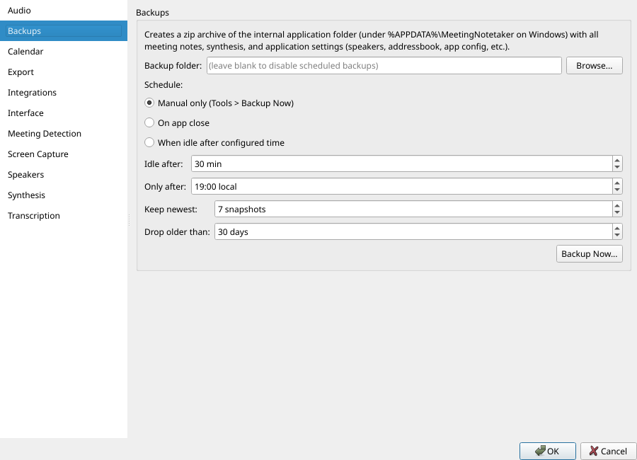

# Settings and backups

## Settings reference

Open via Tools > Settings... (`Ctrl+,`) or the tray menu. All of
these are also editable directly in `config.toml`.

| Setting | Default | What it does |
|---|---|---|
| Your name | (empty, "Me") | Replaces "Me:" in the transcript display and in the synthesis prompt. When set, the LLM sees your real name and assigns action items by name instead of "TBD". |
| Model size | `small.en` | Which faster-whisper model to use. See [Choosing a model](../../README.md#choosing-a-model). |
| Capture-only mode | **on** | Skip live transcription; run a single Whisper pass when you click Stop. v0.6.5+ default. Lower CPU during the meeting. Per-session override available in the New Session dialog. |
| Skip post-Stop refinement | off | Make the live transcript final. No second Whisper pass after you click Stop. |
| High accuracy mode | off | Off = greedy decoding (beam_size=1); on = beam_size=5 (slower, slightly more accurate). |
| CPU threads per worker | 0 (auto) | CTranslate2 `cpu_threads`. 0 derives from `cpu_count() / num_workers`, minimum 2. |
| Parallel workers | 2 | CTranslate2 `num_workers`. Lets independent transcribe() calls run truly in parallel. |
| Retain audio (default) | off | Default state of the "Keep recording" checkbox for new sessions. |
| Retained format | Opus | Opus / FLAC / WAV. Opus trims a 1-hour meeting from about 1 GB to about 45 MB with no practical speech-quality loss. |
| Auto-capture interval | 30 s | Cadence for the screen-capture auto-mode (5-300 s range). |
| Auto-capture dedup threshold | 10 bits | Sensitivity for the dHash-based duplicate filter (0-32, of 64 bits). |
| Enable VAD | on | Trim silent stretches before Whisper decodes them. |
| VAD min silence (ms) | 500 | How quiet a stretch has to be (in ms) before VAD treats it as silence. |
| Mic device | (System default) | Persists by name so the same device is picked after replug. |
| Loopback device | (System default) | WASAPI loopback. Windows-only. |
| Custom vocabulary | (empty) | One phrase per line in `vocabulary.txt`. Per-session hotwords also auto-derived from `# Attendees` and agenda. |
| Watch Outlook calendar | off | Poll Outlook for upcoming meetings. Click a tray notification to open New Session with the meeting subject plus attendees plus agenda pre-filled. |
| Notify within (min) | 5 | How far in advance to surface the calendar notification. |
| Detect ad-hoc meetings | off | Watch the Windows audio mixer for sustained audio from a known meeting app (Teams, Zoom, ...). |
| Enable speaker identification | on | Run the post-meeting clustering pass. Disable to keep generic "Them:" labels. |
| Match threshold | 75% | Cosine-similarity floor for matching a meeting voice against a stored speaker. |
| Merge threshold | 75% | Cosine-similarity floor for merging two clusters into one during the agglomerative pass. |
| Manage Speakers... | n/a | Opens the speaker-library editor. |
| Enable synthesis via MCP | off | Reveals the Start web UI button, the stdio config snippet, the auto-start tick-box, and the Web UI export destinations group. |
| Start the web UI automatically when Meeting Notetaker launches | off | Background-starts the web UI on every app launch. Pair with the Chrome Claude extension. |
| Web UI export destinations | all off | Three check-boxes (Obsidian, Notion, Confluence) picking which Save-to destinations surface in the web UI's per-meeting export dropdown. Each stays disabled until the matching integration is configured and verified below. |
| Notion integration token | (empty) | Internal Integration Token from notion.so/my-integrations. Enables Save to Notion when Verify succeeds. |
| Confluence base URL | (empty) | Tenant root (Cloud: `https://your-org.atlassian.net/wiki`). |
| Confluence email plus API token | (empty) | Email plus token from id.atlassian.com. Enables Save to Confluence when Verify succeeds. |
| Obsidian vault path | (empty) | Absolute path to an Obsidian vault directory. Enables Save to Obsidian when Verify vault succeeds. |
| Obsidian note location | `By series + date` | Template that picks the subfolder and filename. `By series + date` (default) is `Meetings/{series}/{YYYY}-{MM}-{DD} - {title}` (chronological order inside each series folder); `Year / Month` is `Meetings/{YYYY}/{MM}` (filename equals session title); `By series` is `Meetings/{series}` (filename equals session title); `Flat` is `Meetings/` (filename equals session title); `Custom...` exposes a free-form template with `{YYYY}` / `{MM}` / `{DD}` / `{title}` / `{series}` / `{session_id}` placeholders. If the template's last segment contains `{title}`, it becomes the filename pattern and everything before is the subdir. |
| Obsidian YAML frontmatter | on | Write a YAML frontmatter block at the top of each saved note. Carries title / date / attendees / series / tags / `source_session_id`. |
| Obsidian wikilinks (attendees + series) | on | Render attendee names and the series in frontmatter as `[[wikilinks]]` so they form graph nodes. |
| Obsidian classification in frontmatter | off | Add the session's classification value to frontmatter. |
| Obsidian include attachments by default | off | Pre-check the "Include attachments" box in the save dialog. Saves a click for users who want every save to bring the attachments with it. |
| Obsidian daily-note backlink | off | After saving, append a backlink to today's daily note (reads the user's Daily Notes or Periodic Notes config to find it). |
| Obsidian open after save | on | Launch `obsidian://open?vault=...&file=...` after the note lands. |

## Backups (v0.7.5+)

Local-machine SPOF mitigation. Pick a destination folder under
Settings > Backups, choose a schedule, and the app writes timestamped
zip snapshots of the data dir plus all sqlite stores. The Tools >
Backup Now... menu fires an immediate snapshot; Tools > Restore from
Backup... picks a zip and atomically swaps the data dir aside before
relaunching.

| Setting | Default | What it does |
|---|---|---|
| Backup folder | (empty, disabled) | Destination for the snapshot zips. Local disk, external drive, NAS, or OneDrive folder all work. |
| Schedule | Manual only | One of: Manual only, On app close, When idle (after configured time). |
| Idle after | 30 min | (When-idle schedule) Minutes of inactivity before a snapshot fires. Resets on any mouse / keyboard activity. |
| Only after | 19:00 local | (When-idle schedule) Earliest local hour the idle trigger may fire. |
| Keep newest | 7 snapshots | Retention cap by count (0 disables). |
| Drop older than | 30 days | Retention cap by age (0 disables). Both gates apply; the intersection survives. |

OneDrive note. OneDrive is safe as a backup target because the
snapshot zips are atomic-once-closed: OneDrive's conflict-resolution
problem only applies to open files being modified. The data dir
itself must stay on local disk: OneDrive sync corrupts the sqlite WAL
files (the live `*.db-wal` / `*-shm` companions get rewritten under
the running connection's feet).

What's in a snapshot. The three primary sqlite stores (`sessions.db`,
`classification.db`, `speakers.db`) plus the FTS5 search index
(`search.db`); `config.toml`, the user's customized prompt templates,
the per-session content (audio plus transcripts plus notes plus
screenshots plus attachments). What's not in a snapshot: the
downloaded faster-whisper models (about 480MB to 1.5GB, re-downloaded
on demand) and the running log files.

Snapshot vs. close. If a backup is running when you close the app, a
modal "Backup in progress" dialog blocks the close until the snapshot
completes (no data loss from a torn zip). When the schedule is "On
app close", the close-path snapshot shows a progress dialog in the
same way.

Restore. Restoring overwrites the current data directory; the
existing dir is preserved as
`.pre-restore.MeetingNotetaker.<timestamp>/` so you can roll back
manually if needed. The app quits at the start of the restore;
relaunch after the swap completes.
