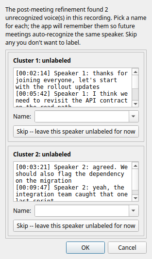
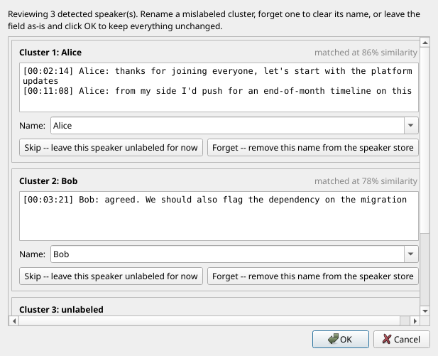
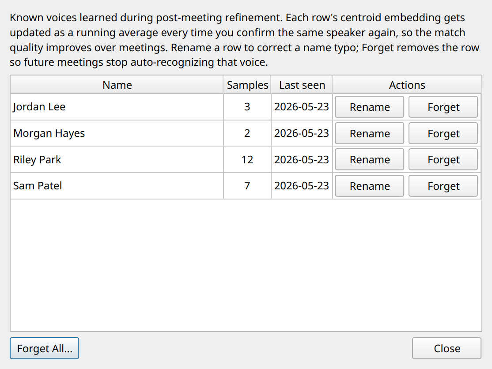

# Speaker identification

After each recording, the app tries to label the system audio side of
the transcript with real names ("Alice:", "Bob:") instead of the
generic "Them:". It learns who is who over time; the first meeting
with a new colleague needs one quick labeling pass; subsequent
meetings recognize that voice automatically. All processing is
on-device.

## What you'll see

If any voice in the recording didn't match the speaker library, the
Label Unknown Speakers dialog pops automatically after the
post-meeting pass. Each card shows the top example transcript lines
for that cluster plus a name field that autocompletes from Outlook
attendees and known speakers:

After the fact, Review Speakers (button on the session view) walks
every detected speaker and lets you rename / forget / confirm:

The speaker library lives at
`%APPDATA%/MeetingNotetaker/speakers.db`. Open via Settings > Manage
Speakers...; Rename / Forget per row, with a Forget All escape hatch:

## Tips for accuracy

The library starts empty. It grows as you label voices, and the
running-average centroid update tightens each stored embedding with
every confirmation.

- Label voices the first time you see them. Use a consistent form
  (`Alice Smith` every time, not `Alice` sometimes); the store keys
  on the exact string.
- Skip what you don't recognize. A bad label trains the wrong
  embedding into the store.
- Use Review Speakers when something looks wrong. Rename pushes the
  centroid update to the new name; the old name's record is unchanged
  (Forget it manually via Manage Speakers if it's corrupted).
- Lean on the Outlook attendee list. Calendar-pre-filled sessions
  have attendee names ready in the name combo box.

Both the merge threshold (within-meeting clustering) and the match
threshold (cross-meeting recognition) are tunable in Settings; see
the [Tuning diarization
thresholds](../../README.md#tuning-diarization-thresholds) subsection
of the Technical Details.
