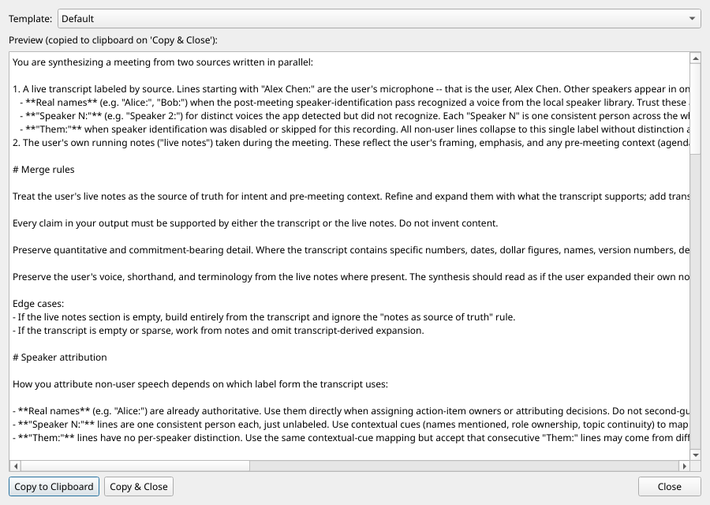
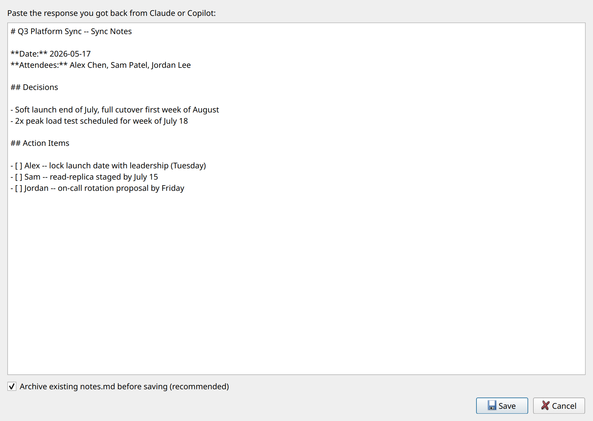
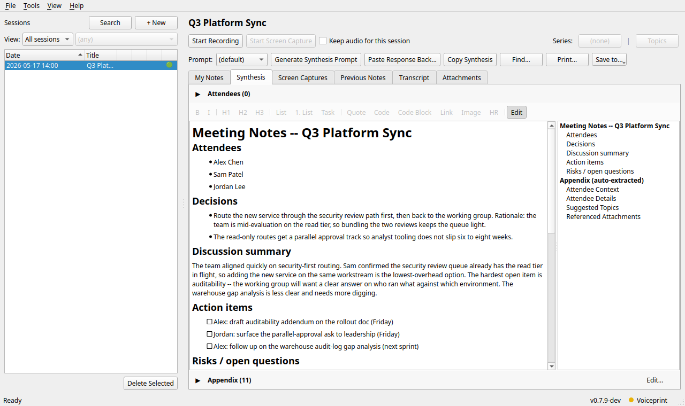

# Synthesis

Two paths cover the hand-off. A manual clipboard flow that works
with any chatbot, and a Settings-wired MCP service layer that Claude
Desktop, Claude Code, and the Chrome Claude extension can drive
directly.

## Manual flow

1. Click Generate Synthesis Prompt. A dialog opens with a template
   picker, a rendered preview of the merged prompt (your live notes
   plus the transcript), and a Copy to clipboard button:

   

2. Paste into your chatbot of choice (Claude.ai, M365 Copilot, etc.).
   Wait for the reply.

3. Copy the response, come back to Meeting Notetaker, click Paste
   Response Back..., paste, save:

   

4. The Synthesis tab now shows the rendered response. If a prior
   notes file existed, it's auto-archived to `notes-YYYYMMDD-HHMM.md`
   and listed under Previous Notes.

The Synthesis tab is editable in place (Markdown source plus Preview
toggle, same as My Notes), so you can polish the LLM's output before
sharing.



The Copy button puts the active tab's contents on the clipboard as
both Markdown and rendered HTML (with images inlined as base64 data:
URIs) for paste into Word / OneNote / Notion / plain editors.
Coverage varies by destination; see the paste-target table in the
[Technical Details](../../README.md#paste-target-coverage-for-copy)
section of the top-level README.

The Print and Save to... buttons render the active tab to a printer
or write it to one of three destinations:

- Save as PDF...: writes a PDF file (images preserved, Markdown links
  clickable, links rendered as black and underlined).
- Save to Notion...: creates a new Notion page under a parent you
  pick. Visible only when Notion is configured and verified under
  Settings > Integrations.
- Save to Confluence...: creates a new Confluence page under a parent
  you pick. Visible only when Confluence is configured and verified.
- Save to Obsidian...: writes a markdown file (with YAML frontmatter
  linking attendees and series) into a configured Obsidian vault.
  Visible only when an Obsidian vault path is configured and verified
  under Settings > Integrations. No remote service involved; the note
  lands on local disk and Obsidian syncs it however the user already
  has it set up (iCloud, Syncthing, Obsidian Sync, etc.). See
  [publishing.md](publishing.md#saving-notes-to-obsidian) below.

The File menu mirrors the same Save to submenu so you can drive the
flow without leaving the menu bar. See
[publishing.md](publishing.md) for the picker dialog walk-through.

### Per-session prompt template

The synthesis tab has a Prompt dropdown that picks which template
(default, one-on-one, standup, or any custom file in
`%APPDATA%\MeetingNotetaker\prompts\`) to use for that session.
Selection persists across app restarts and feeds both the manual
hand-off above and the MCP tools below.

## Synthesis via MCP

Starting in v0.8, synthesis automation moves off the bundled Chrome
extension to a local MCP service layer. Two transports expose the
same ten tools; pick whichever your Claude surface supports. One-page
setup is in [../mcp-setup.md](../mcp-setup.md).

| Claude surface | Transport |
| :--- | :--- |
| Chrome Claude extension (claude.ai in-browser) | Local web UI at `http://127.0.0.1:PORT/` |
| Claude Desktop | stdio MCP server (`--mcp-server`) |
| Claude Code | stdio MCP server (`--mcp-server`) |

Your meetings never leave the machine either way. The web UI binds
loopback. The stdio server reads JSON-RPC on stdin and writes to
stdout; nothing crosses the network at all.

### Enabling MCP

Open Settings > Synthesis via MCP and tick Enable synthesis via MCP.
The pane then offers:

- Start web UI and open in browser (launches the local web UI,
  default `127.0.0.1:8765` with 20 port fallbacks, and points your
  default browser at it). The server runs for the rest of the Meeting
  Notetaker session.
- Start the web UI automatically when Meeting Notetaker launches
  (one-time tick-box; every subsequent app launch starts the web UI
  in the background).
- Copy config to clipboard (hands you the JSON snippet to paste into
  Claude Desktop's `claude_desktop_config.json` or `claude mcp add`
  for Claude Code).
- Web UI export destinations: three check-boxes (Obsidian, Notion,
  Confluence) that pick which Save-to destinations surface in the web
  UI's per-meeting export dropdown. Each is disabled until the
  matching integration is configured and verified under Settings >
  Integrations.

### Claude Desktop and Claude Code (stdio)

Paste the Settings-generated snippet into your client:

```json
{
  "mcpServers": {
    "meeting-notetaker": {
      "command": "C:\\Program Files\\MeetingNotetaker\\meeting-notetaker.exe",
      "args": ["--mcp-server"]
    }
  }
}
```

Restart the client. Then ask it to "list my meetings" or "synthesize
the latest meeting and save it"; it calls the typed tools directly
with no page-scraping involved.

### Chrome Claude extension (local web UI)

The Chrome Claude extension's Custom Connectors list only accepts
remote MCP server URLs and refuses private IPs, so a stdio localhost
server has nowhere to be pasted. The web UI gives the extension a
page to drive instead.

1. Start the web UI from Settings (or launch Meeting Notetaker with
   the auto-start tick-box on).
2. In Chrome, grant the Claude extension Site Access to
   `http://127.0.0.1:*/*` (or the specific port you pick).
3. Import the shipped Claude Agent Skill (see
   [../../claude-skill/README.md](../../claude-skill/README.md)) so
   the extension knows which page is which.
4. Open the extension sidebar on the local page and ask it to
   synthesize a meeting; it follows links, reads the rendered prompt,
   drafts notes, and submits the Save form.

### What the pages offer

- `/meetings` lists meetings with filters (state, series, person,
  topic, has transcript, has synthesis, limit). Each row links to a
  detail page.
- `/meetings/<id>` carries a sticky left-sidebar table of contents,
  then overview, attendees, live notes, transcript, current
  synthesis, an Export dropdown (destinations driven by your
  Settings tick-boxes), and the synthesis workflow (template picker,
  rendered prompt, Save textarea, Save button).
- `/templates` is the configured prompt templates.
- `/api/...` is the JSON mirror of every HTML route and every
  mutating action, for scripts and automation.

### Status bar

The Syn pill in the status bar reports the MCP state: green when at
least one transport is running, gray when disabled. Hover for the
full description.
